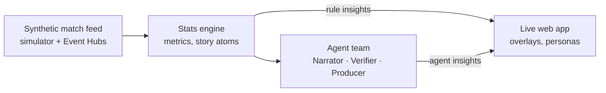

# KOORA

**Explainable, personalised match intelligence from synthetic football data, built on Microsoft Azure.**

KOORA ingests a live stream of synthetic match events and tracking data, turns it into grounded statistics and story atoms, and uses a team of AI agents to explain why moments matter. Every insight is rendered as a timed on-screen overlay and tailored to each viewer's persona, club, favourite player and language.

> Built for the Microsoft × Premier League *Inside the Game* Developer Hackathon. All data is synthetic; all clubs and players are fictional.

## How it works



1. **Ingest.** The simulator streams events and 25 Hz tracking frames.
2. **Interpret.** The stats engine computes pass difficulty, speeds, distances and momentum, and turns notable patterns into *story atoms*: structured facts with evidence.
3. **Explain.** Agents narrate only what the atoms contain. A Verifier rejects any unsupported claim.
4. **Render.** Insights arrive as renderer-agnostic overlay specs timed to the match clock.
5. **Personalise.** Insights are generated per audience segment (persona × language × club), so cost stays flat as viewers grow.

Details: [docs/architecture.md](docs/architecture.md) · Assumptions: [docs/assumptions.md](docs/assumptions.md)

## Microsoft and Azure technologies

| Layer | Technology |
| --- | --- |
| Hosting | Azure Container Apps, Azure Container Registry |
| Observability | Azure Monitor (Log Analytics, Application Insights) |
| Infrastructure as code | Bicep, Azure Developer CLI (`azd`) |
| CI/CD | GitHub Actions with federated credentials |
| Planned | Microsoft Foundry + Agent Framework, Event Hubs, Cosmos DB, Web PubSub, Azure AI Speech, Teams |

## Quick start

Requires Python 3.11+.

```bash
python -m venv .venv
# Windows: .venv\Scripts\activate    macOS/Linux: source .venv/bin/activate
pip install -e ".[dev]"

pytest                                   # run the tests
uvicorn koora.api.main:app --reload      # open http://127.0.0.1:8000
python -m koora.simulator.fake_feed --minutes 3 > feed.jsonl   # sample event stream
```

## Repository layout

```
src/koora/contracts/     shared data contracts (events, story atoms, insights)
src/koora/simulator/     synthetic match generation
src/koora/stats_engine/  deterministic metrics and story atoms
src/koora/agents/        Narrator, Verifier, Producer
src/koora/api/           HTTP API, serves the web app
src/web/                 live web app
docs/                    architecture, assumptions, hackathon reference
tests/                   pytest suite
```

## Licence

[MIT](LICENSE)
