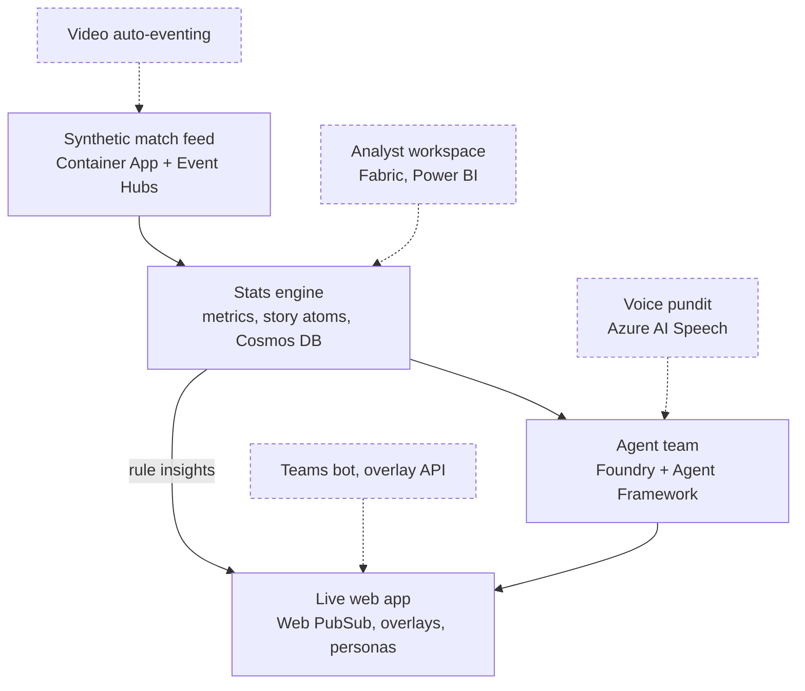

# Architecture

## Core spine (minimum build)

Solid boxes are the minimum build. Dashed boxes are optional modules; each plugs into one contract and never requires changes to the core.

## Contracts

All three live in `src/koora/contracts/schemas.py`.

| Contract | From → to | Key types |
| --- | --- | --- |
| Event schema | simulator / video → stats engine | `StreamMessage`, `MatchMetadata`, `TrackingFrame`, `MatchEvent` |
| Story atom schema | stats engine → agents | `StoryAtom`, `MetricValue` |
| Insight schema | stats engine + agents → app | `Insight`, `Audience`, `OverlaySpec`, `Verification` |

## Hot path vs agent path

- **Hot path (deterministic, sub-second):** player tags, speed and distance badges, pass cards. Produced by the stats engine with `origin="rule"`.
- **Agent path (seconds):** narratives, explanations, recaps, answers. Produced by agents with `origin="agent"`, always verified or replaced by a template fallback.

## Agents

| Agent | Role |
| --- | --- |
| Narrator | Writes from story atoms per persona, club, player focus and language |
| Verifier | Rejects claims not backed by atom metrics, facts and evidence IDs |
| Producer | Decides what reaches the screen: priority, de-duplication, pacing, TTL |

Failure recovery: Verifier rejection loops, timeouts with template fallback (`Verification.status = "fallback"`), and the Producer dropping stale insights.

## Current deployment (day 1)

`azd up` provisions a resource group with Log Analytics, Application Insights, a Container Registry, a user-assigned identity, a Container Apps environment and the `api` Container App, which also serves `src/web`. Further services are added to `infra/resources.bicep` as each layer comes online.
